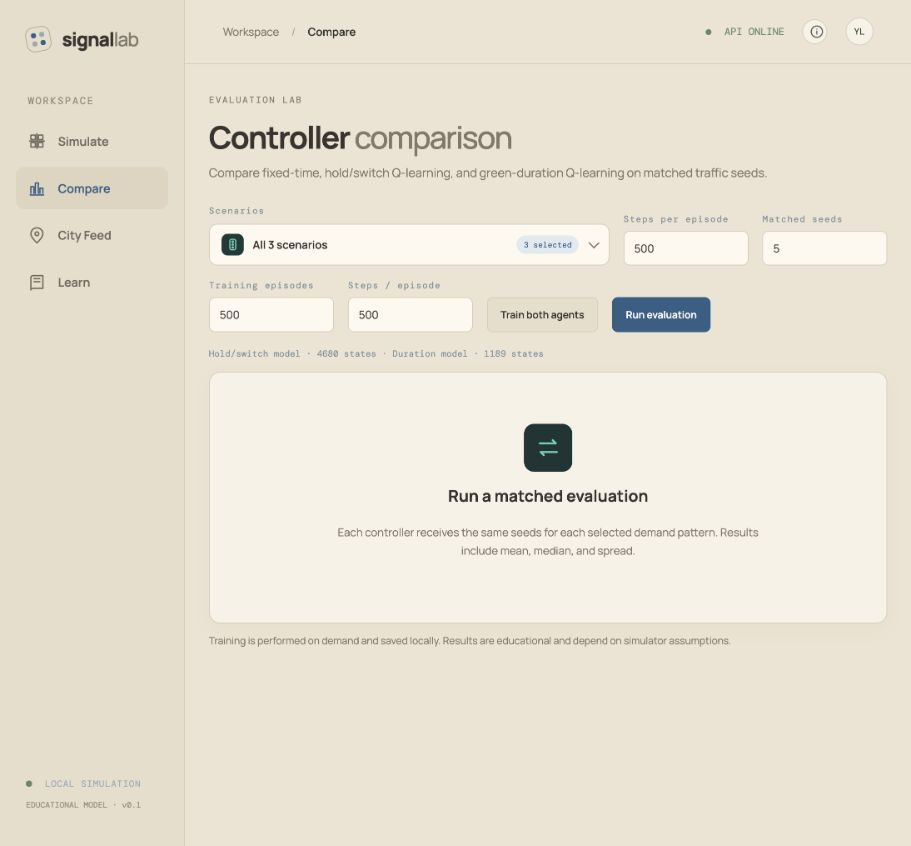
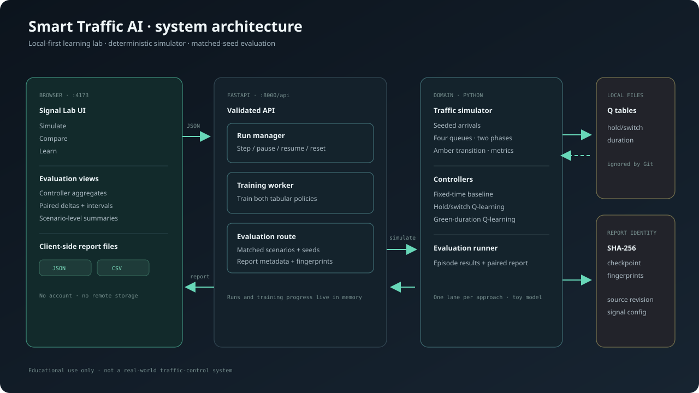

# Smart Traffic AI — Signal Lab

An educational traffic-signal-control lab. Run a four-way intersection, inspect what tabular Q-learning observes and chooses, and compare two learned policies with a fixed-time baseline under matched traffic seeds.

> **Simulation only.** This simplified, single-lane model is not suitable for real roads or signal control.



## Quick start

Requires Python 3.10 or newer. The frontend is static HTML/CSS/JavaScript and has no Node.js build step.

Clone the repository, then create a virtual environment and install the backend requirements:

```sh
git clone https://github.com/yashpal-2004/Smart-Traffic-AI.git
cd Smart-Traffic-AI
python3 -m venv .venv
source .venv/bin/activate
python -m pip install --upgrade pip
python -m pip install -r backend/requirements.txt
```

Start the API in terminal 1:

```sh
PYTHONPATH=backend python -m uvicorn app.main:app --app-dir backend --reload
```

Start the frontend in terminal 2 from the repository root:

```sh
python3 -m http.server 4173 --bind 127.0.0.1 --directory frontend
```

Open [http://127.0.0.1:4173](http://127.0.0.1:4173). Interactive API documentation is at [http://127.0.0.1:8000/docs](http://127.0.0.1:8000/docs).

On a clean clone, both Q-learning policies start untrained. Open **Compare**, choose training episodes and steps per episode, then select **Train both agents**. Checkpoint files are created locally in `backend/artifacts/` and are intentionally ignored by Git. The fixed-time baseline works without training.

## What is included

- **Simulate:** run, pause, step, and reset seeded traffic; inspect queues, phase, wait, throughput, and controller decisions.
- **Compare:** evaluate fixed-time, hold/switch Q-learning, and green-duration Q-learning on the same selected scenarios and seeds. Review per-seed deltas, scenario summaries, and uncertainty intervals.
- **Learn:** read the simulator's state, actions, reward choices, and limitations.
- **Export:** download complete evaluation reports as JSON or typed-row CSV. Reports include seed protocol, configuration, scenario arrival rates, checkpoint fingerprints, and source revision metadata.

## Measured controller comparison

Controlled run recorded in the progress log: both tabular learners trained for 1,500 episodes × 500 steps, then evaluated on 15 held-out episodes (five seeds across three scenarios).

| Controller | Mean served wait (s) | Mean queue length | Mean served vehicles |
|---|---:|---:|---:|
| Fixed-time | 11.10 | 12.80 | 544.6 |
| Hold/switch Q-learning | 15.31 | 19.26 | 531.1 |
| Green-duration Q-learning | 12.34 | 14.99 | 538.9 |

The duration policy beat the hold/switch learner in this recorded run, but both learned policies trailed fixed-time. These are results from one simulator configuration and a small held-out set; they are not evidence of real-world performance or a general RL improvement. The JSON and CSV for a reproducible sample run are in [`docs/sample-evaluation/`](docs/sample-evaluation/).

The **City Feed** page also reads live, read-only lane-volume and detector-occupancy measurements from [Brisbane City Council's intersection-volume dataset](https://data.brisbane.qld.gov.au/explore/dataset/traffic-data-at-intersection/) (CC BY 4.0). Flow is reported per signal-controller cycle. The feed is for monitoring and analysis only; it does not control signals or feed the simulator's compass-direction model.

### Traffic forecasting workflow

From the repository root, first open **City Feed** and capture an unfiltered snapshot to discover site IDs. Then start collecting that site's timestamped observations while the backend is running:

```bash
python3 backend/scripts/collect_traffic_history.py --interval 60 --site-id "YOUR_SITE_ID"
```

Replace `YOUR_SITE_ID` with the ID shown in the City Feed selector. Stop with `Ctrl+C`. Local SQLite data is stored in ignored `backend/data/traffic_history.sqlite3`. The dashboard's **Capture snapshot** button also targets the selected site and can backfill its recent available records. After at least 24 unique source timestamps for a site, choose that site and select **Train & evaluate forecast**. The report compares a lag-based ridge regression with a persistence baseline on the final 20% of the timeline and reports MAE/RMSE plus a next-cycle estimate. A lower model error is not guaranteed; the project does not call the estimate an hourly forecast and does not feed the aggregate count into directional signal control.

Metric definitions: served wait is average queueing time for vehicles served during an episode; queue length is the average number waiting after each simulation step; served vehicles is total throughput in the episode. Scenario definitions and interval assumptions are included in each report.

## Architecture



The simulator and policies are independent of the web layer. The browser sends JSON to FastAPI; the API runs the same deterministic simulator for live runs and matched-seed evaluation. See [the architecture notes](docs/02-TECHNICAL-ARCHITECTURE.md) for endpoint and persistence details.

## Repository map

```text
backend/app/simulator/       deterministic traffic world and metrics
backend/app/agents/          fixed-time and tabular Q-learning policies
backend/app/evaluation/      matched-seed runner and report summaries
backend/app/api/             FastAPI endpoints and in-memory run manager
backend/tests/               simulator, agent, evaluation, and API checks
frontend/                    static Signal Lab UI
docs/                         project, architecture, milestone, and experiment docs
```

## Limitations

- One intersection, one lane per approach, two opposing phases, and simplified vehicle movement.
- Bernoulli arrivals; no turning movements, pedestrians, emergency vehicles, spillback, detector errors, or safety certification.
- Tabular state/action spaces are small; current learned policies underperform the fixed-time baseline in the recorded controlled comparison.
- Runs and training progress are process-local. Training restarts from the beginning after a server restart; checkpoints persist locally once training completes.
- Confidence intervals depend on paired-difference assumptions and become unstable with few seeds. Compare scenario-level results and increase matched seeds before drawing conclusions.

## Documentation

- [Project brief](docs/00-PROJECT-BRIEF.md)
- [Product and UI guide](docs/01-PRODUCT-AND-UI.md)
- [Technical architecture](docs/02-TECHNICAL-ARCHITECTURE.md)
- [Milestones](docs/03-MILESTONES.md)
- [Agent handoff](docs/04-AGENT-HANDOFF.md)
- [Decisions and progress log](docs/05-DECISIONS-AND-PROGRESS.md)
